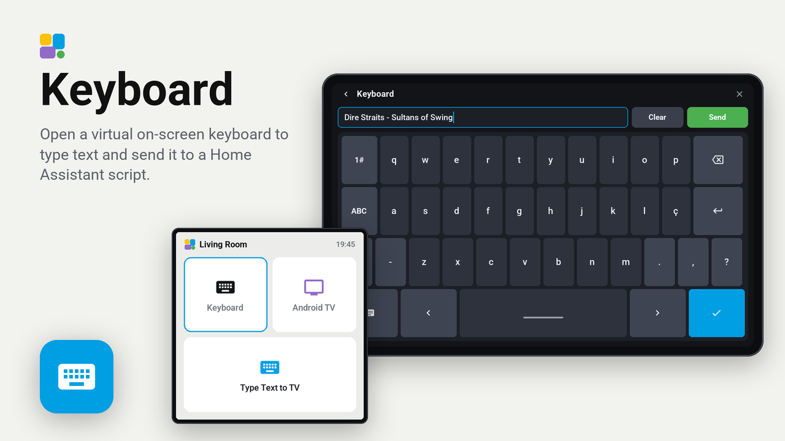

# Keyboard — Tessera Plugin (`keyboard`)



A [Tessera (ESP Screen Manager)](https://github.com/MaxGramser/esp-screen-manager) plugin that adds a dashboard tile and a full-width on-screen virtual keyboard card to type text directly on your ESPHome smart display and send it to a Home Assistant `script`.

---

## Features

- **Dashboard Tile (`keyboard`):** Clean tile with a keyboard icon and customizable label (`1x1` to `2x2` grid cells) that opens the virtual keyboard modal card when tapped.
- **Tap Action (`open_keyboard`):** Can also be attached as a tap action on `script`, `media_player`, or `input_text` tiles.
- **Responsive Full-Width Virtual Keyboard Card (`wide: true`):**
  - **Landscape (`width > height`):** Places the single-line text input box, **Clear**, and **Send** buttons along a single compact top row so the keyboard matrix utilizes the full screen width and maximum vertical height.
  - **Portrait (`height >= width`):** Stacks the text input box on the first row, **Clear** and **Send** buttons on the second row, and the keyboard matrix below.
- **Custom LVGL Button Maps & Material Design Icons:**
  - Includes Lowercase (`abc`), Uppercase (`ABC`), and Numbers/Symbols (`1#`) layouts with `ç` / `Ç` support.
  - Uses a composite LVGL fallback font combining `Font::TITLE` with `Font::ICON_SMALL` so Material Design Icons (`backspace-outline`, `keyboard-return`, `keyboard-outline`, `chevron-left`, `chevron-right`, `check`) render crisply on every key without requiring FontAwesome symbols.
- **Home Assistant Script Integration:** Calls your configured Home Assistant `script` entity and passes the typed string in the `input_text` field (`{"input_text": "<typed text>"}`).

---

## Tested Hardware & Size / Display Limitations

> [!IMPORTANT]
> **Tested Device Notice:** This plugin has been **tested exclusively on the author's device: Guition JC8012P4A1 V3** (10.1-inch `1280×800` IPS MIPI-DSI capacitive touch display powered by an **ESP32-P4**). It has not been tested on other boards or display panels.

### Size & Resolution Limitations

1. **Tile Grid Size (`1x1` to `2x2`):**
   - The dashboard tile supports grid spans from `1x1` (minimum) up to `2x2` (maximum) and uses approximately `600 B` of tile memory.
2. **Screen Resolution & Physical Size (12-Column QWERTY Matrix):**
   - The virtual keyboard card opens in **full-width mode** (`wide: true`) and renders a **12-column** button matrix across 4 rows (`41` keys in alpha modes, `40` keys in symbol mode).
   - It is designed for large **`standard`-look displays** (such as `1280×800` landscape or `800×1280` portrait panels).
   - On small **`compact`-look screens** (such as `320×240` or `480×272` CYD displays), the 12 columns and top input bar may be too narrow or vertically cramped for comfortable finger typing.
3. **Font & Flash Footprint:**
   - Requires approximately `16 KB` of flash and extends `materialdesign_icons` / `materialdesign_icons_mini` with three keyboard glyphs (`\U000F0311`, `\U000F0312`, `\U000F0B5C`).
4. **Payload Length Limit:**
   - The `input_text` string submitted to Home Assistant is subject to Tessera's Home Assistant action payload limit (`1 KB`).

---

## Installation in Tessera

1. Open the **Tessera (ESP Screen Manager)** add-on in Home Assistant.
2. Go to the **Plugins** tab and click **Add plugin by link**.
3. Paste the repository URL:
   ```text
   https://github.com/fabiobrolo/tessera-plugin-keyboard
   ```
4. Select your screen, enable the **Keyboard** plugin, and select your **Target script** (`target_script`).
5. Add the **Keyboard** tile to any page on your screen (or assign the **Open Keyboard** tap action to an existing tile), then compile/install the updated firmware on your ESPHome device.

---

## Home Assistant Script Configuration

The plugin requires a Home Assistant **Script** (`script.*`) that accepts an input field named **`input_text`**.

### Example 1: Send Typed Text to the Currently Open App on Android TV (via ADB)

If you have an Android TV integrated via `androidtv` (ADB) and want to type directly into whichever app and search/input field is currently focused on the TV screen (e.g., YouTube search bar, Netflix, Plex, Jellyfin, browser, or system login), use Android's `input text` ADB shell command followed by `input keyevent 66` (`KEYCODE_ENTER`):

```yaml
alias: Send Text to Active App on Android TV
description: Types input_text into the currently focused field on Android TV via ADB and presses Enter
fields:
  input_text:
    name: Text to type
    description: Text sent by the Tessera Keyboard plugin
    required: true
    selector:
      text:
sequence:
  - action: androidtv.adb_command
    target:
      entity_id: media_player.androidtv_salao_festas_adb
    data:
      command: >-
        {% set clean = input_text | string
           | replace('á','a') | replace('à','a') | replace('ã','a') | replace('â','a')
           | replace('Á','A') | replace('À','A') | replace('Ã','A') | replace('Â','A')
           | replace('é','e') | replace('ê','e') | replace('É','E') | replace('Ê','E')
           | replace('í','i') | replace('Í','I')
           | replace('ó','o') | replace('õ','o') | replace('ô','o') | replace('Ó','O') | replace('Õ','O') | replace('Ô','O')
           | replace('ú','u') | replace('ü','u') | replace('Ú','U') | replace('Ü','U')
           | replace('ç','c') | replace('Ç','C')
           | replace('\\', '\\\\') | replace('"', '\\"') | replace("'", "\\'")
           | replace(' ', '%s') %}
        input text "{{ clean }}" && input keyevent 66
mode: single
icon: mdi:keyboard
```

> [!NOTE]
> Android's `input text` command requires spaces to be encoded as `%s` and only supports ASCII characters. The Jinja2 template above automatically normalizes common accented characters (`ç` -> `c`, `ã` -> `a`, etc.) and escapes quotes before injecting the text into the focused Android TV input box.

### Example 2: Open YouTube Search Results Directly on Android TV (via ADB Intent)

If you prefer to launch the YouTube app directly on a search results page regardless of which app is currently open:

```yaml
alias: Search YouTube on Android TV
fields:
  input_text:
    name: Search query
    required: true
    selector:
      text:
sequence:
  - action: androidtv.adb_command
    target:
      entity_id: media_player.androidtv_salao_festas_adb
    data:
      command: >-
        am start -a android.intent.action.VIEW -d
        "vnd.youtube://www.youtube.com/results?search_query={{ input_text | urlencode }}"
mode: single
icon: mdi:youtube
```

---

## License

MIT License — see [LICENSE](LICENSE).
